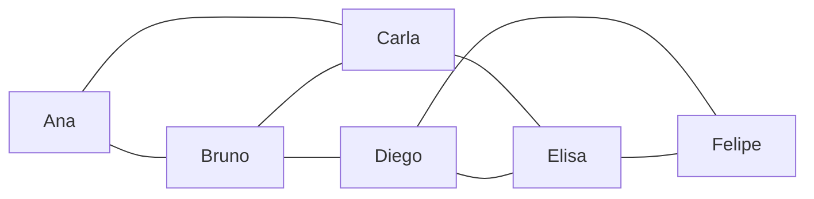
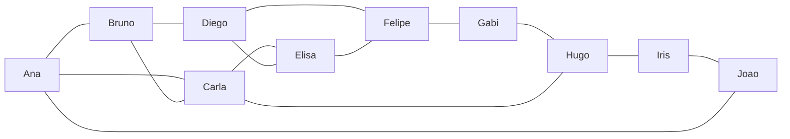

# Projeto ConectaUDF: redes sociais com grafos

**Disciplina:** Algoritmos / Matemática Discreta / Ciência de Dados

**Integrantes:** Herik Acioly, Herbert Paulo, Jean Teófilo porto, Jonathan Teófilo Porto e Kauã Alves.

---

## 1. Introdução

A ConectaUDF é uma rede social fictícia. Como a amizade é recíproca, usamos um **grafo não direcionado**: cada usuário é um vértice e cada amizade é uma aresta.

Neste trabalho representamos a rede em grafo, calculamos graus, número de arestas e densidade, encontramos caminhos e ampliamos a rede no desafio em grupo.

---

## 2. Desenho do grafo (rede original)



As oito amizades: Ana–Bruno, Ana–Carla, Bruno–Carla, Bruno–Diego, Carla–Elisa, Diego–Elisa, Diego–Felipe e Elisa–Felipe.

---

## 3. Tabela de graus

| Usuário | Amigos diretos | Grau |
|---|---|:---:|
| Ana | Bruno, Carla | 2 |
| Bruno | Ana, Carla, Diego | 3 |
| Carla | Ana, Bruno, Elisa | 3 |
| Diego | Bruno, Elisa, Felipe | 3 |
| Elisa | Carla, Diego, Felipe | 3 |
| Felipe | Diego, Elisa | 2 |

**Pergunta 1: quem tem mais conexões diretas?**
Bruno, Carla, Diego e Elisa empatam, cada um com grau 3.

---

## 4. Número de amizades

Cada aresta é contada duas vezes na soma dos graus:

- Soma dos graus: 2 + 3 + 3 + 3 + 3 + 2 = **16**
- Número de arestas = 16 ÷ 2 = **8**

Existem **8 amizades** no grafo, o que confere com a lista original.

---

## 5. Densidade

Para um grafo simples não direcionado:

```
D = 2 × E / (V × (V − 1))
D = 2 × 8 / (6 × (6 − 1)) = 16 / 30
```

- Resultado decimal: **0,533**
- Resultado percentual: **53,3%**

**Interpretação:** a rede tem 8 das 15 amizades possíveis, um pouco mais da metade. É uma densidade moderada: há bastante conexão, mas ainda existe espaço para novas amizades. Ana e Felipe, nas pontas, têm só dois amigos cada.

---

## 6. Caminhos de Ana até Felipe

| Caminho | Arestas |
|---|:---:|
| Ana → Bruno → Diego → Felipe | 3 |
| Ana → Carla → Elisa → Felipe | 3 |

Os dois caminhos têm 3 arestas, que é o menor valor possível: Ana e Felipe não são amigos diretos nem têm amigo em comum. Há também caminhos mais longos, como Ana → Bruno → Carla → Elisa → Felipe (4 arestas).

---

## 7. Desafio em grupo: rede ampliada

Adicionamos quatro usuários fictícios (**Gabi, Hugo, Iris e Joao**) e seis novas amizades: Felipe–Gabi, Gabi–Hugo, Hugo–Iris, Iris–Joao, Ana–Joao e Carla–Hugo.



### Graus após a ampliação

| Usuário | Grau |
|---|:---:|
| Ana | 3 |
| Bruno | 3 |
| Carla | 4 |
| Diego | 3 |
| Elisa | 3 |
| Felipe | 3 |
| Gabi | 2 |
| Hugo | 3 |
| Iris | 2 |
| Joao | 2 |

- Soma dos graus: **28**, então E = 28 ÷ 2 = **14 amizades**
- Densidade: D = 2 × 14 / (10 × 9) = 28 / 90 ≈ **0,311 (31,1%)**
- Usuária com mais conexões: **Carla** (grau 4)

### Comparação de densidade

| | Antes | Depois |
|---|:---:|:---:|
| Usuários | 6 | 10 |
| Amizades | 8 | 14 |
| Pares possíveis | 15 | 45 |
| Densidade | 53,3% | 31,1% |

A densidade caiu porque os pares possíveis triplicaram (15 para 45), enquanto as amizades subiram menos (8 para 14). Redes maiores tendem a ser menos densas, pois ninguém conhece todo mundo.

### Como a rede pode recomendar uma nova amizade

A rede conta os **amigos em comum** entre pessoas que ainda não são amigas e sugere as de maior contagem. Na rede ampliada, os melhores casos são:

- **Bruno e Elisa:** 2 amigos em comum (Carla e Diego)
- **Carla e Diego:** 2 amigos em comum (Bruno e Elisa)

---

## 8. Código Python

```python
"""Projeto ConectaUDF: redes sociais com grafos."""

# PARTE 1: rede original
rede = {
    "Ana": ["Bruno", "Carla"],
    "Bruno": ["Ana", "Carla", "Diego"],
    "Carla": ["Ana", "Bruno", "Elisa"],
    "Diego": ["Bruno", "Elisa", "Felipe"],
    "Elisa": ["Carla", "Diego", "Felipe"],
    "Felipe": ["Diego", "Elisa"],
}


def analisar(rede, titulo):
    """Mostra graus, total de usuarios, arestas e densidade."""
    print(f"=== {titulo} ===")
    n = len(rede)

    for usuario, amigos in rede.items():
        print(usuario, "tem", len(amigos), "conexoes")

    soma_graus = sum(len(amigos) for amigos in rede.values())
    arestas = soma_graus // 2
    densidade = (2 * arestas) / (n * (n - 1))

    print("Total de usuarios:", n)
    print("Total de amizades:", arestas)
    print(f"Densidade: {densidade:.2%}")

    maior_grau = max(len(a) for a in rede.values())
    mais_conectados = [u for u, a in rede.items() if len(a) == maior_grau]
    print("Mais conexoes:", ", ".join(mais_conectados), f"(grau {maior_grau})")
    print()
    return densidade


densidade_antes = analisar(rede, "Rede original")


# PARTE 2: desafio em grupo
def adicionar_amizade(rede, a, b):
    """Cria a amizade nos dois sentidos (grafo nao direcionado)."""
    rede.setdefault(a, [])
    rede.setdefault(b, [])
    if b not in rede[a]:
        rede[a].append(b)
    if a not in rede[b]:
        rede[b].append(a)


novas_amizades = [
    ("Felipe", "Gabi"),
    ("Gabi", "Hugo"),
    ("Hugo", "Iris"),
    ("Iris", "Joao"),
    ("Ana", "Joao"),
    ("Carla", "Hugo"),
]

for a, b in novas_amizades:
    adicionar_amizade(rede, a, b)

densidade_depois = analisar(rede, "Rede ampliada")

print("Comparacao de densidade:")
print(f"  Antes:  {densidade_antes:.2%}")
print(f"  Depois: {densidade_depois:.2%}")
print()


# PARTE 3: recomendacao por amigos em comum
def recomendar(rede, usuario):
    meus_amigos = set(rede[usuario])
    sugestoes = []

    for outro, amigos in rede.items():
        if outro == usuario or outro in meus_amigos:
            continue
        em_comum = meus_amigos & set(amigos)
        if em_comum:
            sugestoes.append((outro, sorted(em_comum)))

    sugestoes.sort(key=lambda s: len(s[1]), reverse=True)
    return sugestoes


print("Sugestoes de amizade:")
for usuario in rede:
    for outro, em_comum in recomendar(rede, usuario):
        print(f"  {usuario} -> {outro} "
              f"({len(em_comum)} em comum: {', '.join(em_comum)})")


# PARTE 4: menor caminho (busca em largura)
def menor_caminho(rede, origem, destino):
    fila = [[origem]]
    visitados = {origem}

    while fila:
        caminho = fila.pop(0)
        atual = caminho[-1]
        if atual == destino:
            return caminho
        for vizinho in rede[atual]:
            if vizinho not in visitados:
                visitados.add(vizinho)
                fila.append(caminho + [vizinho])
    return None


print()
caminho = menor_caminho(rede, "Ana", "Felipe")
print("Menor caminho Ana -> Felipe:", " -> ".join(caminho))
print("Arestas no caminho:", len(caminho) - 1)
```

**Saída esperada (trecho):**

```
=== Rede original ===
Total de usuarios: 6
Total de amizades: 8
Densidade: 53.33%

=== Rede ampliada ===
Total de usuarios: 10
Total de amizades: 14
Densidade: 31.11%

Menor caminho Ana -> Felipe: Ana -> Bruno -> Diego -> Felipe
Arestas no caminho: 3
```

---

## 9. Pergunta de reflexão

**Duas pessoas ainda não são amigas, mas têm três amigos em comum. Como usar isso para sugerir uma nova conexão?**

Três amigos em comum indicam que as duas provavelmente frequentam os mesmos círculos. A rede pode contar os vizinhos compartilhados de cada par e sugerir as conexões com contagem mais alta. Esse princípio é chamado de *fechamento triádico* ("amigos de amigos").

**Cuidados de privacidade ao analisar redes sociais:**

- Pedir consentimento e ser transparente sobre o uso dos dados de conexões.
- Evitar sugestões que exponham relações sensíveis (ex-parceiro, paciente, usuário bloqueado).
- Permitir que o usuário opte por não aparecer como sugestão.
- Minimizar e anonimizar os dados nas análises, respeitando leis como a LGPD.
- Lembrar que a rede de contatos pode revelar informações que a pessoa nunca compartilhou, como saúde, orientação ou posição política.

---

## 10. Conclusão

Representar a ConectaUDF como grafo permitiu medir a rede com poucas fórmulas: o grau mostra quem é mais conectado, a soma dos graus dividida por 2 dá o número de amizades, e a densidade indica quanto da rede possível já existe. Ao ampliar a rede de 6 para 10 usuários, a densidade caiu de 53,3% para 31,1%, mostrando que redes maiores tendem a ser mais esparsas. A contagem de amigos em comum é uma forma simples e eficaz de recomendar amizades, desde que acompanhada de cuidados com a privacidade.
